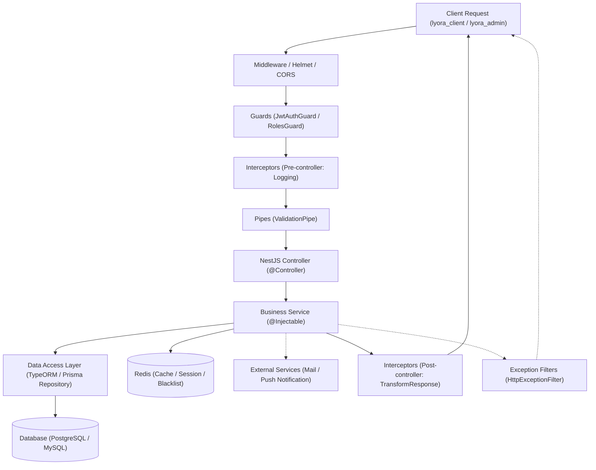

# Backend Architecture (`lyora_backend`)

Backend của hệ thống được xây dựng bằng **NestJS** trên nền tảng **Node.js** và **TypeScript**, đặt tại thư mục **`lyora_backend/`** trong cấu trúc Monorepo.

---

## 1. Các luồng hoạt động chính (API Flow)

Dựa trên kiến trúc chuẩn của NestJS, luồng hoạt động của mọi request API diễn ra như sau:

---

## 2. Ranh giới kiến trúc Monorepo & Bảo mật Secrets

- **Độc lập tuyệt đối:** `lyora_backend` là một workspace backend độc lập. Không phụ thuộc vào source code của `lyora_client` hay `lyora_admin`.
- **Không chia sẻ Secrets với `lyora_web_shared`:**
  - Toàn bộ thông tin nhạy cảm (Database URL, Database Password, JWT Secret, Redis URL, API Keys bên thứ ba) **BẮT BUỘC** được lưu trữ trong file `.env` nội bộ của `lyora_backend` và nạp qua `ConfigService`.
  - **TUYỆT ĐỐI KHÔNG** chia sẻ các secrets này sang `lyora_web_shared` hoặc bất kỳ nơi nào có thể bị đóng gói vào bundle của trình duyệt.
- **Loại bỏ i18n:** Backend trả về các mã lỗi chuẩn (`statusCode`, `error`, `message`) bằng tiếng Việt thống nhất; không duy trì hệ thống đa ngôn ngữ `nestjs-i18n`.

---

## 3. Nguồn chân lý (Source of Truth)
- Module tham chiếu chuẩn: `AuthModule` (`auth.controller.ts`, `auth.service.ts`, `jwt.strategy.ts`).
- Đọc tiếp các quy định chi tiết tại:
  - [API Rules (Controller, Service, DTO, Repository)](api_rules.md)
  - [Security & Performance Rules](security_and_performance.md)
  - [Development Workflow & API Lifecycle](workflow.md)
