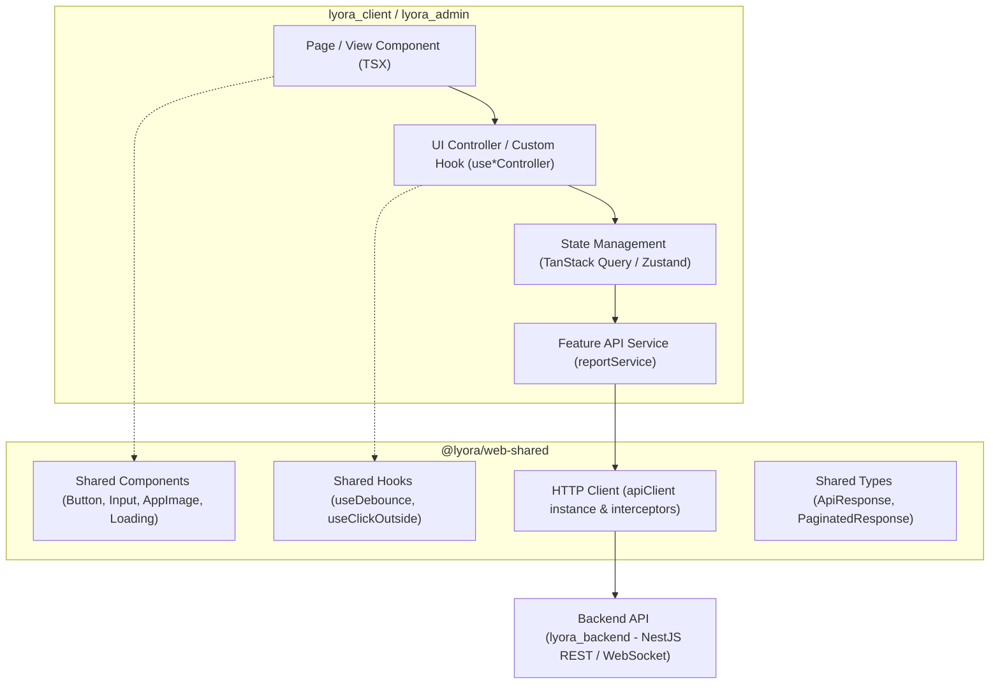

# Kiến trúc hệ thống Web Client (Architecture)

Dự án Web Frontend được thiết kế dựa trên kiến trúc phân lớp hướng tính năng (Feature-based Clean Architecture) kết hợp với gói tài nguyên dùng chung **`@lyora/web-shared`**, phục vụ đồng thời cho 2 ứng dụng độc lập: **`lyora_client`** và **`lyora_admin`**.

## Sơ đồ luồng kiến trúc (Architecture Flow)

## Phân định trách nhiệm các Layer

1. **Shared Resources Layer (`lyora_web_shared`):**
   - Đóng gói các UI components nguyên tử (Button, Input, Loading, AppImage), hooks tiện ích, types chung và `apiClient` Axios instance tập trung.
   - Quản lý cấu hình ESLint dùng chung (`sharedEslintConfig`) và file môi trường dùng chung (`.env`).
2. **UI Presentation Layer (`src/components/`, `src/features/<feature>/components/`, `src/pages/`):**
   - Chứa các React Component phụ trách render giao diện của từng ứng dụng.
   - Tận dụng các component dùng chung từ `@lyora/web-shared`.
   - Sử dụng một giao diện thống nhất theo `DESIGN.md` (không có Light/Dark mode).
3. **UI Controller / Custom Hook Layer (`use<Feature>Controller.ts`):**
   - Quản lý Local UI State (mở/đóng dialog, cờ loading tạm thời, form state).
   - Điều phối actions người dùng và gọi các mutations/queries từ State Layer.
4. **Shared State Layer (Zustand Store / TanStack Query):**
   - **Server State (TanStack Query):** Cache, revalidate dữ liệu từ backend API.
   - **Client State (Zustand):** Lưu phiên đăng nhập (Token, User profile) của từng ứng dụng.
5. **Feature Service Layer (`src/features/<feature>/services/`):**
   - Đóng gói các hàm gọi API nghiệp vụ riêng của từng ứng dụng dựa trên `apiClient` dùng chung.

## Các quy tắc bắt buộc

- Mọi tài nguyên có thể dùng chung giữa Client và Admin phải được đặt tại `lyora_web_shared`.
- Không gọi trực tiếp API client từ Component mà phải thông qua Custom Hook / Service.
- Không đưa backend secrets hoặc private keys vào `lyora_web_shared` hay frontends.
- Sử dụng ngôn ngữ Tiếng Việt thống nhất trên toàn bộ giao diện; không dùng i18n.
