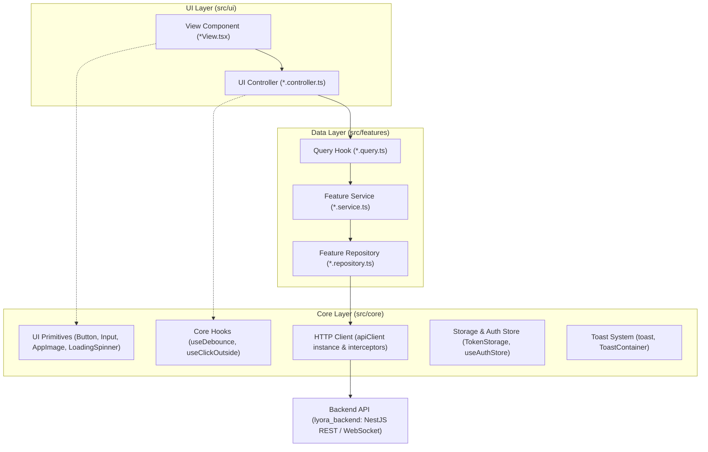

# Kiến trúc hệ thống Web Client (`lyora_web`)

Dự án Web Frontend được thiết kế dựa trên kiến trúc 4 Layer phân tách độc lập, phục vụ đồng thời cho cả hai phân hệ: Cổng Khách Hàng (`src/ui/client`) và Trung Tâm Quản Trị (`src/ui/admin`).

---

## 1. Sơ đồ luồng kiến trúc (Architecture Flow)

---

## 2. Phân định trách nhiệm các Layer

1. **Core Layer (`src/core/`):**
   - Đóng gói các UI primitives nguyên tử (`Button`, `Input`, `LoadingSpinner`, `AppImage`), hooks hạ tầng, types chung và `apiClient` Axios instance tập trung.
   - Quản lý storage, token storage, auth store, toast notification system.
2. **Data Layer (`src/features/`):**
   - Thuần TypeScript module (không chứa JSX/TSX).
   - Đóng gói logic giao tiếp mạng qua Repository, business rules qua Service, và quản lý cache qua TanStack Query hooks.
3. **UI Layer (`src/ui/`):**
   - Tổ chức theo đúng 3 module: `admin`, `auth`, `client`.
   - Áp dụng mô hình View-Controller: View chỉ khởi tạo Controller 1 lần và gọi trực tiếp `controller.property` hoặc `controller.handleAction`.
   - Sử dụng một giao diện thống nhất theo `DESIGN.md` (không có Light/Dark mode).
4. **Router Layer (`src/routes/`):**
   - Quản lý URL paths, phân chia quyền hạn qua `RoleRoute` và `GuestRoute`.

---

## 3. Các quy tắc bắt buộc

- Mọi tài nguyên hạ tầng dùng chung phải đặt tại `src/core/`.
- Không gọi trực tiếp API client từ View hay Controller; phải thông qua Query Hook -> Service -> Repository.
- Không đưa backend secrets hoặc private keys vào `lyora_web`.
- Sử dụng ngôn ngữ Tiếng Việt thống nhất trên toàn bộ giao diện; không dùng i18n.
