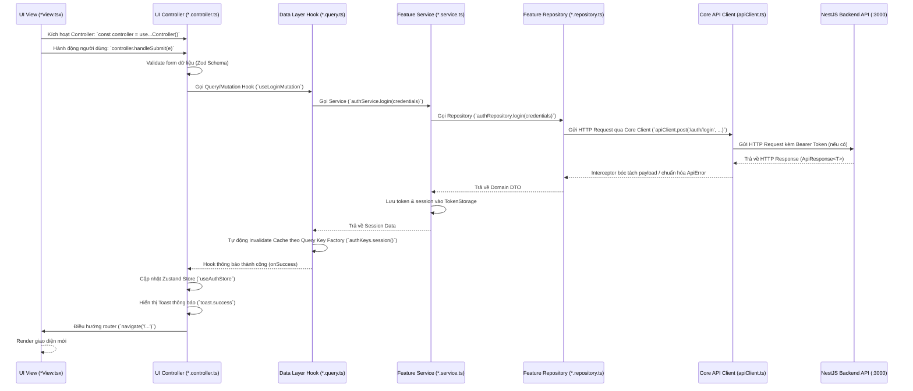

# Data Flow & State Management (`lyora_web`)

Ứng dụng `lyora_web` tuân thủ mô hình **Luồng dữ liệu một chiều (Unidirectional Data Flow)** kết hợp phân tầng nghiêm ngặt giữa View Layer, Data Layer, Core Hạ tầng và Backend NestJS.

---

## 1. Sơ đồ tuần tự hoàn chỉnh (Sequence Diagram)



---

## 2. Chiến lược Cache & Invalidation (TanStack Query)

### 2.1. Cấu hình Cache Mặc định (AppProviders)
Tất cả các truy vấn dữ liệu được cấu hình tập trung trong [AppProviders.tsx](file:///d:/study/ute/4%20-%20HK1/CongNghePhanMemMoi/Project/Lyora/lyora_web/src/core/providers/AppProviders.tsx):

- **`staleTime: 10 phút` (600,000 ms):** Dữ liệu được coi là mới (fresh) trong 10 phút. Trong thời gian này, các component truy cập lại query sẽ nhận ngay dữ liệu từ memory mà không phát sinh thêm HTTP request lên backend.
- **`gcTime: 15 phút` (900,000 ms):** Thời gian lưu giữ dữ liệu không sử dụng trong bộ nhớ trước khi giải phóng (Garbage Collection).
- **`retry: 1`:** Tự động thử lại 1 lần nếu gặp sự cố mạng gián đoạn.
- **`refetchOnWindowFocus: false`:** Không tự động refetch khi người dùng chuyển qua lại giữa các tab trình duyệt.

### 2.2. Query Key Factories (`*.keys.ts`)
Tuyệt đối không hardcode chuỗi query key trong codebase. Mỗi feature trong Data Layer phải có một Query Key Factory phân cấp:

```typescript
// src/features/auth/hooks/auth.keys.ts
export const authKeys = {
  all: ['auth'] as const,
  session: () => [...authKeys.all, 'session'] as const,
  profile: () => [...authKeys.all, 'profile'] as const,
};

// src/features/system/hooks/system.keys.ts
export const systemKeys = {
  all: ['system'] as const,
  health: () => [...systemKeys.all, 'health'] as const,
};
```

### 2.3. Cache Invalidation
Khi mutation làm thay đổi dữ liệu, sử dụng Query Key Factory để làm mới cache chính xác:
```typescript
queryClient.invalidateQueries({ queryKey: authKeys.session() });
```
