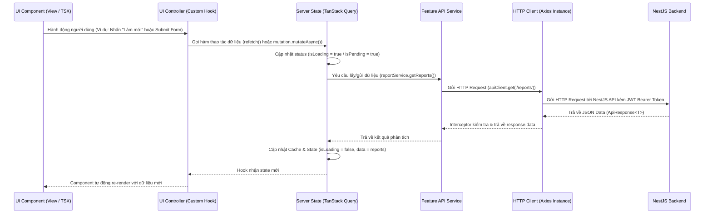

# Data Flow & State Management

Ứng dụng Web Client ReactJS sử dụng mô hình **Luồng dữ liệu một chiều (Unidirectional Data Flow)** kết hợp với hai giải pháp quản lý trạng thái:
- **Server State (TanStack Query):** Chịu trách nhiệm fetch, cache, revalidate và đồng bộ dữ liệu với Backend.
- **Client/Global State (Zustand hoặc Context API):** Chịu trách nhiệm quản lý phiên người dùng (Auth/Session), theme (Light/Dark mode), và các trạng thái toàn cục của ứng dụng.

## Sơ đồ luồng dữ liệu (Sequence Diagram)

## Giải thích chi tiết các bước trong luồng

1. **User Action:** Bắt đầu khi người dùng tương tác với UI Component (click, submit, đổi trang).
2. **UI Controller Hook:** Tiếp nhận sự kiện, xác thực điều kiện phía client (nếu có), sau đó gọi hàm tương ứng từ State Layer (Mutation hoặc Query).
3. **Query/Mutation Layer:**
   - Đảm bảo trạng thái loading/error được cập nhật tự động.
   - Quản lý cache key và tự động hủy request cũ nếu component bị unmount (qua AbortController).
4. **Service & HTTP Client:**
   - Service đóng gói endpoint và format payload.
   - Axios Client đảm nhận việc thêm Authorization Header (`Bearer <token>`), xử lý Timeout, và bắt lỗi mạng hoặc mã HTTP lỗi (401, 403, 500).
5. **State Update & Re-render:**
   - Khi có dữ liệu trả về, TanStack Query lưu vào cache và kích hoạt re-render đối với tất cả các Component đang quan sát (subscribe) dữ liệu đó.
   - Nếu là Mutation (ví dụ: tạo mới phản ánh thành công), thực hiện `queryClient.invalidateQueries({ queryKey: ['reports'] })` để tự động làm mới danh sách dữ liệu hiển thị.
